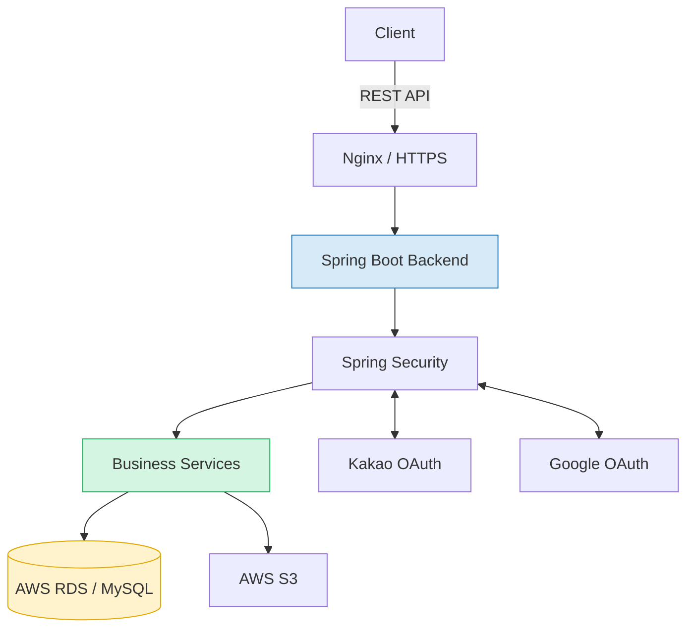
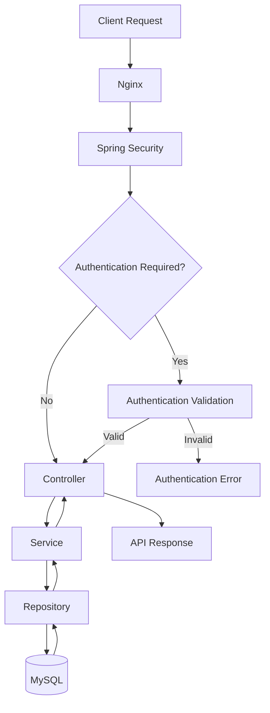
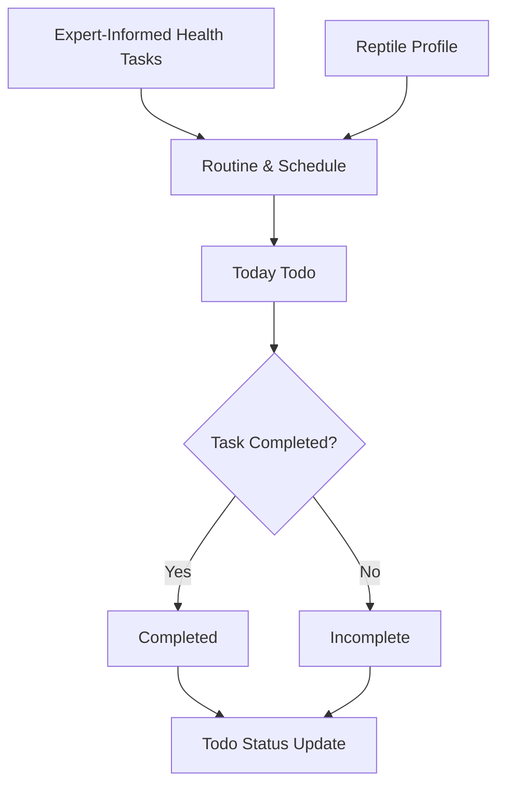
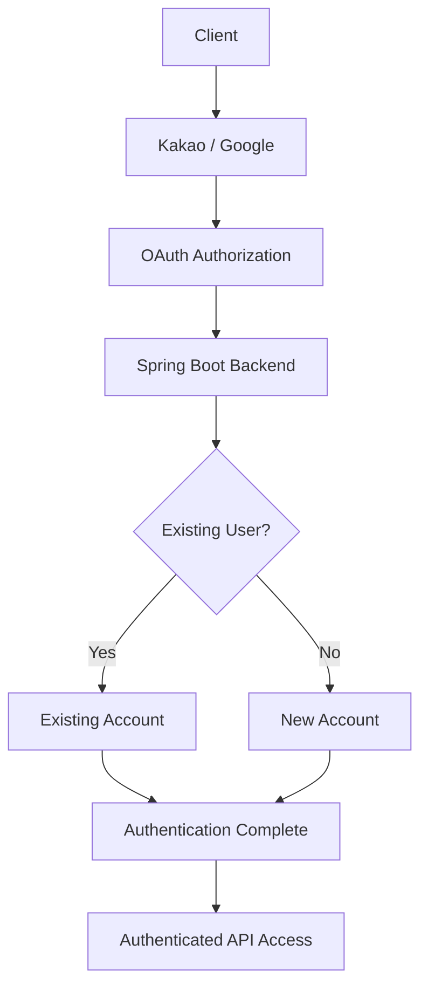
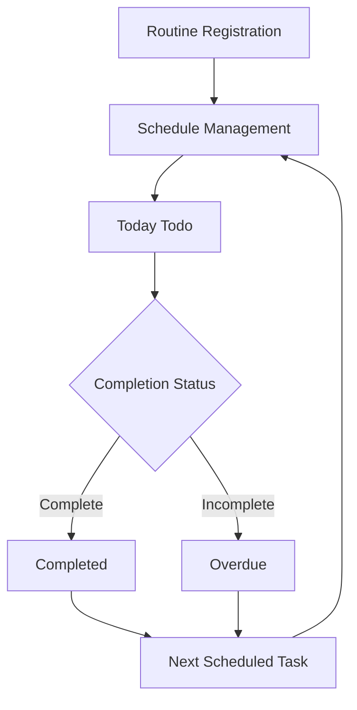
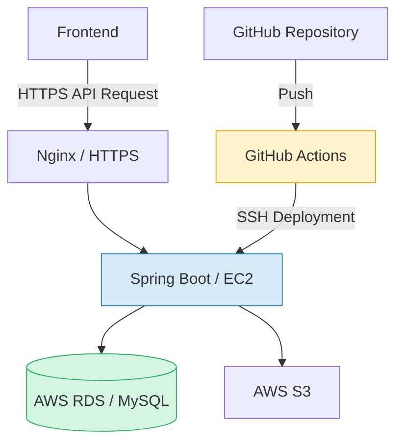
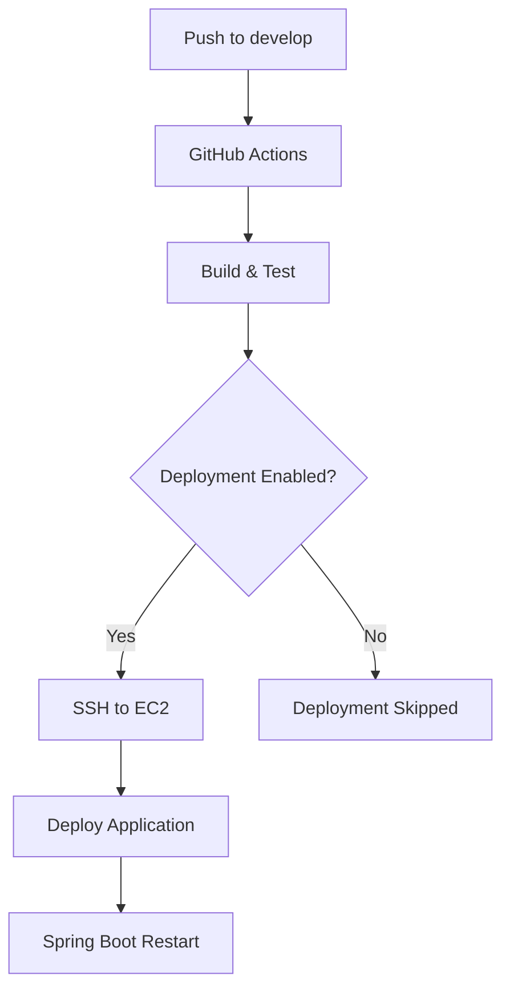

<div align="center">

# 🦎 PABOM

### 수의학 전문가 자문 기반 반려 파충류 건강 관리 서비스

**Expert-Informed Reptile Care & Daily Health Management**

수의학 전문가의 자문을 바탕으로 구성된 건강 관리 할 일 목록을 제공하고,  
반려 파충류의 일상과 건강 기록을 체계적으로 관리할 수 있도록 돕는 서비스

<br/>


<br/>


<br/>

**PABOM Backend**

</div>

---

## 📌 1. Project Overview

### 프로젝트 소개

**PABOM**은 수의학 전문가의 자문을 바탕으로 반려 파충류에게 필요한 건강 관리 항목을 제공하고, 보호자가 일상 속에서 체계적으로 실천할 수 있도록 돕는 **반려 파충류 건강 관리 서비스**입니다.

반려 파충류는 종마다 적절한 사육 환경과 관리 방법이 다르며, 급여, 탈피, 환경 관리 등 지속적인 관찰과 관리가 중요합니다.

PABOM은 이러한 특성을 고려하여 **수의학 전문가 자문 기반 건강 관리 할 일 목록(To-Do List)**을 제공하고, 보호자가 필요한 관리 항목을 확인하고 수행할 수 있도록 지원합니다.

또한 개체별 일상 및 건강 기록을 통합 관리하여 반려 파충류의 지속적이고 체계적인 돌봄을 돕습니다.

### 핵심 목표

- 수의학 전문가 자문 기반 건강 관리 할 일 제공
- 반려 파충류의 일상적인 돌봄 일정 관리
- 오늘 할 일 및 완료 상태 관리
- 반복적인 건강 관리 루틴 설정
- 개체별 일상 및 건강 기록 통합 관리
- 반려 파충류의 지속적인 건강 관리 지원
- 안정적인 REST API 및 클라우드 서버 환경 구축

### Core Concept

> **Expert-Informed Care. Daily Tasks. Healthier Reptiles.**

---

## 🏗️ 2. System Architecture

PABOM 백엔드는 **Spring Boot 기반 REST API 서버**로 구성됩니다.

클라이언트는 HTTPS를 통해 백엔드 API에 접근하며, 서버는 사용자 인증, 반려 파충류 정보, 건강 관리 할 일, 루틴 및 기록 관련 비즈니스 로직을 처리합니다.

서비스 데이터는 MySQL 기반 AWS RDS에 저장하고, 이미지 등의 파일은 AWS S3를 통해 관리합니다.



### Request Flow



---

## ✨ 3. Key Features

| 기능 | 설명 |
|------|------|
| 🩺 Expert-Informed Todo | 수의학 전문가 자문 기반 반려 파충류 건강 관리 할 일 제공 |
| ✅ Today Todo | 오늘 수행할 관리 항목 조회 및 완료 상태 관리 |
| 📅 Routine Management | 반복적인 건강 관리 일정 설정 및 관리 |
| 🦎 Reptile Management | 반려 파충류 등록, 조회, 수정 및 삭제 |
| 📝 Record Management | 개체별 일상 및 건강 기록 관리 |
| 🕒 Record History | 기록 정정 및 변경 이력 관리 |
| ♻️ Record Recovery | Soft Delete 기반 기록 삭제 및 복구 |
| 🔎 Record Filtering | 개체, 기록 유형 및 날짜별 필터링 |
| 📄 Cursor Pagination | 커서 기반 기록 목록 페이지네이션 |
| 🔐 Social Login | 카카오 및 구글 OAuth 기반 로그인 |
| 👤 User Management | 사용자 정보 조회 및 회원 탈퇴 |
| 📷 File Management | AWS S3 기반 파일 관리 |

---

## 🩺 4. Expert-Informed Health Todo

PABOM의 핵심 기능은 **수의학 전문가의 자문을 바탕으로 구성된 반려 파충류 건강 관리 할 일 목록**입니다.

반려 파충류는 종과 개체별로 관리 환경과 생활 주기가 다르기 때문에, 보호자가 일상에서 필요한 관리 항목을 꾸준히 확인하고 수행하는 것이 중요합니다.

PABOM은 건강 관리 항목과 반복 루틴을 통해 이러한 일상적인 돌봄을 지원합니다.

### 주요 기능

- 수의학 전문가 자문 기반 건강 관리 항목 제공
- 오늘 수행할 관리 항목 조회
- 할 일 완료 상태 관리
- 반복적인 관리 일정 확인
- 과거 미완료 항목 관리
- 반려 파충류별 건강 관리 일정 관리

### Todo Management Flow



### Todo Status Policy

오늘 할 일 목록은 각 루틴의 현재 유효한 예정일을 기준으로 상태를 관리합니다.

| 상태 | 기준 |
|------|------|
| DUE | 예정일 당일 |
| OVERDUE | 예정일 다음 날부터 6일 경과까지 |
| 미표시 | 예정일로부터 7일 경과 시점부터 |

동일 루틴의 미완료 항목은 매일 중복 누적하지 않으며, 각 할 일의 유효한 예정일을 기준으로 표시 여부를 결정합니다.

---

## 🔐 5. Authentication & User Management

PABOM은 **카카오와 구글 OAuth 2.0 기반 소셜 로그인**을 지원합니다.

별도의 이메일 및 비밀번호 회원가입 없이 소셜 계정을 통해 서비스를 이용할 수 있습니다.

### Authentication Flow



### Account Management

- 카카오 및 구글 소셜 로그인
- 인증된 사용자 정보 조회
- 회원 탈퇴 처리
- 탈퇴 시 개인정보 및 관련 데이터 정리
- 탈퇴 계정 복구 미지원
- 동일 소셜 계정 재로그인 시 신규 계정 생성

---

## 🦎 6. Reptile & Record Management

### Reptile Management

사용자는 반려 파충류의 개체 정보를 등록하고 관리할 수 있습니다.

- 반려 파충류 등록
- 개체 목록 및 상세 조회
- 개체 정보 수정
- 개체 삭제
- 사용자별 개체 데이터 관리

### Record Management

반려 파충류의 일상 및 건강 관련 정보를 기록하고 조회할 수 있습니다.

- 기록 직접 등록
- 기록 목록 및 상세 조회
- 기록 정정
- 기록 정정 이력 관리
- 기록 Soft Delete
- 삭제 기록 복구
- 개체 및 기록 유형별 필터링
- 날짜 범위 기반 기록 조회
- 커서 기반 페이지네이션

### Record Pagination

기록 목록 조회는 **커서 기반 페이지네이션**을 사용합니다.

| 항목 | 정책 |
|------|------|
| 정렬 기준 | `occurredAt DESC`, `id DESC` |
| 기본 조회 크기 | 20개 |
| 최대 조회 크기 | 50개 |
| 조회 기간 | 최대 366일 |
| Cursor | `occurredAt`, `id` 기반 |
| 삭제 기록 조회 | 최근 30일 삭제 기록 포함 가능 |

---

## 📅 7. Routine Management

PABOM은 반려 파충류의 반복적인 건강 관리 일정을 루틴으로 관리합니다.

보호자는 급여, 환경 관리 등 지속적으로 수행해야 하는 관리 항목을 루틴으로 관리하고, 오늘 할 일 목록에서 해당 일정을 확인할 수 있습니다.

### 주요 기능

- 반복 루틴 등록 및 관리
- 루틴별 예정일 관리
- 오늘 할 일 목록 연동
- 완료 및 미완료 상태 관리
- 과거 미완료 항목 표시
- 동일 루틴의 미완료 항목 중복 방지

### Routine Workflow



---

## 🛠️ 8. Tech Stack

### Backend

| Category | Technology |
|----------|------------|
| Language | Java 21 |
| Framework | Spring Boot |
| Security | Spring Security |
| ORM | Spring Data JPA |
| Database | MySQL |
| Database Migration | Flyway |
| Build Tool | Gradle |
| API Documentation | Swagger / OpenAPI |

### Infrastructure & DevOps

| Category | Technology |
|----------|------------|
| Cloud | AWS |
| Application Server | Amazon EC2 |
| Database | Amazon RDS |
| File Storage | Amazon S3 |
| Reverse Proxy | Nginx |
| HTTPS | Let's Encrypt |
| CI/CD | GitHub Actions |
| OS | Ubuntu 24.04 LTS |
| Region | ap-northeast-2 (Seoul) |

### Authentication

| Category | Technology |
|----------|------------|
| Social Login | Kakao OAuth 2.0 |
| Social Login | Google OAuth 2.0 |
| Authentication | Spring Security |

---

## 📂 9. Project Structure

본 저장소는 Spring Boot 기반 백엔드 프로젝트입니다.

아래는 도메인 중심 패키지 구성 예시입니다.

```text
pabom-backend/
│
├── src/
│   ├── main/
│   │   ├── java/
│   │   │   └── .../
│   │   │       ├── domain/
│   │   │       │   ├── auth/
│   │   │       │   ├── user/
│   │   │       │   ├── pet/
│   │   │       │   ├── record/
│   │   │       │   ├── routine/
│   │   │       │   └── todo/
│   │   │       │
│   │   │       └── global/
│   │   │           ├── config/
│   │   │           ├── exception/
│   │   │           └── security/
│   │   │
│   │   └── resources/
│   │       ├── application.yml
│   │       └── db/
│   │           └── migration/
│   │
│   └── test/
│
├── gradle/
├── .github/
│   └── workflows/
│
├── build.gradle
├── settings.gradle
├── gradlew
├── gradlew.bat
└── README.md
```

### Layered Architecture

| Layer | Responsibility |
|-------|----------------|
| Controller | REST API 요청 및 응답 처리 |
| Service | 비즈니스 로직 처리 |
| Repository | 데이터베이스 접근 |
| Entity | 데이터 모델 및 영속성 관리 |
| DTO | API 요청 및 응답 데이터 전달 |
| Global | 공통 설정, 인증 및 예외 처리 |

---

## 🚀 10. Getting Started

### Requirements

- Java 21
- MySQL
- Git

### 1. Clone Repository

```bash
git clone <REPOSITORY_URL>

cd <REPOSITORY_NAME>
```

### 2. Database Configuration

로컬 MySQL에 개발용 데이터베이스를 생성합니다.

```sql
CREATE DATABASE pabom
CHARACTER SET utf8mb4
COLLATE utf8mb4_unicode_ci;
```

Spring Boot 애플리케이션 설정에서 데이터베이스 연결 정보를 구성합니다.

```yaml
spring:
  datasource:
    url: jdbc:mysql://localhost:3306/pabom
    username: ${DB_USERNAME}
    password: ${DB_PASSWORD}
```

> 위 설정은 로컬 개발용 예시이며, 실제 설정 파일의 환경 변수명 및 프로필 구성에 맞게 변경해야 합니다.

### 3. Environment Configuration

주요 환경 변수 예시:

| Configuration | Description |
|---------------|-------------|
| DB_USERNAME | MySQL 사용자명 |
| DB_PASSWORD | MySQL 비밀번호 |
| KAKAO_CLIENT_ID | 카카오 OAuth Client ID |
| GOOGLE_CLIENT_ID | 구글 OAuth Client ID |
| GOOGLE_CLIENT_SECRET | 구글 OAuth Client Secret |
| AWS_S3_BUCKET | S3 버킷 이름 |
| AWS_REGION | AWS 리전 |

실제 환경 변수명은 프로젝트 설정 파일을 기준으로 사용합니다.

> API Key, OAuth Secret, 데이터베이스 비밀번호 등 민감한 정보는 GitHub에 업로드하지 않습니다.

### 4. Run Spring Boot

Windows:

```bash
.\gradlew.bat bootRun
```

macOS / Linux:

```bash
./gradlew bootRun
```

기본 로컬 서버 주소:

```text
http://localhost:8080
```

---

## 📚 11. API Documentation

PABOM은 Swagger / OpenAPI를 사용하여 REST API 명세를 관리합니다.

### Swagger UI

Swagger UI를 통해 REST API 명세를 확인할 수 있습니다.

API 문서는 개발 및 테스트 환경에서 관리하며, 접근 권한은 환경별 보안 정책에 따라 설정합니다.

### API Response Format

성공 응답 예시:

```json
{
  "resultType": "SUCCESS",
  "success": {
    "data": {}
  },
  "error": null
}
```

실패 응답 예시:

```json
{
  "resultType": "FAIL",
  "success": null,
  "error": {
    "code": "ERROR_CODE",
    "message": "에러 메시지",
    "details": null
  }
}
```

### Main API Categories

| Category | Description |
|----------|-------------|
| Auth | 소셜 로그인 및 인증 |
| User | 사용자 정보 조회 및 탈퇴 |
| Reptile | 반려 파충류 정보 관리 |
| Record | 기록 등록, 조회, 정정, 삭제 및 복구 |
| Routine | 반복 루틴 관리 |
| Todo | 건강 관리 할 일 및 완료 상태 관리 |

---

## ☁️ 12. Infrastructure & Deployment

PABOM은 AWS 기반 클라우드 환경에서 서비스를 운영하도록 구성합니다.

### Deployment Architecture



### Deployment Environment

PABOM은 개발 및 운영 환경을 분리하여 관리합니다.

| Environment | Description |
|-------------|-------------|
| Development | 내부 개발 및 테스트 환경 |
| Production | 실제 서비스 운영 환경 |

### Deployment Components

- AWS EC2 기반 Spring Boot 서버 실행
- AWS RDS MySQL 데이터베이스 연동
- AWS S3 기반 파일 저장
- Nginx 리버스 프록시 구성
- Let's Encrypt 기반 HTTPS 적용
- GitHub Actions 기반 CI/CD 구성

---

## 🔄 13. CI/CD

GitHub Actions를 통해 백엔드 빌드 및 배포 작업을 자동화합니다.

### Development Deployment Flow



### Deployment Strategy

| Environment | Branch | Deployment |
|-------------|--------|------------|
| Development | `develop` | GitHub Actions |
| Production | 별도 운영 브랜치 | 운영 정책에 따라 구성 |

개발 환경 배포는 GitHub Actions Secrets 및 배포 활성화 설정을 통해 관리합니다.

---

## 🧪 14. Build & Test

### Build

Windows:

```bash
.\gradlew.bat clean build
```

macOS / Linux:

```bash
./gradlew clean build
```

### Test

Windows:

```bash
.\gradlew.bat test
```

macOS / Linux:

```bash
./gradlew test
```

---

## 🌿 15. Git Convention

### Branch Strategy

```text
main
develop
feature/<issue-number>-<description>
fix/<issue-number>-<description>
refactor/<description>
```

### Commit Convention

| Type | Description |
|------|-------------|
| feat | 새로운 기능 추가 |
| fix | 버그 수정 |
| refactor | 코드 리팩토링 |
| docs | 문서 추가 및 수정 |
| test | 테스트 코드 추가 및 수정 |
| chore | 빌드 및 설정 관련 작업 |
| style | 코드 스타일 변경 |
| perf | 성능 개선 |

### Commit Examples

```bash
feat: 반려 파충류 등록 API 구현
feat: 건강 관리 오늘 할 일 조회 기능 구현
fix: 기록 커서 페이지네이션 오류 수정
refactor: 인증 서비스 로직 분리
docs: Swagger API 명세 업데이트
test: 기록 삭제 및 복구 통합 테스트 추가
```

---

## 🔗 16. Project Links

| Category | Link |
|----------|------|
| Service | https://pabom.app |
| API Documentation | Swagger / OpenAPI |

---

<div align="center">

### 🦎 PABOM

**Expert-Informed Reptile Care & Daily Health Management**

*Expert-Informed Care · Daily Tasks · Healthier Reptiles*

<br/>

</div>

